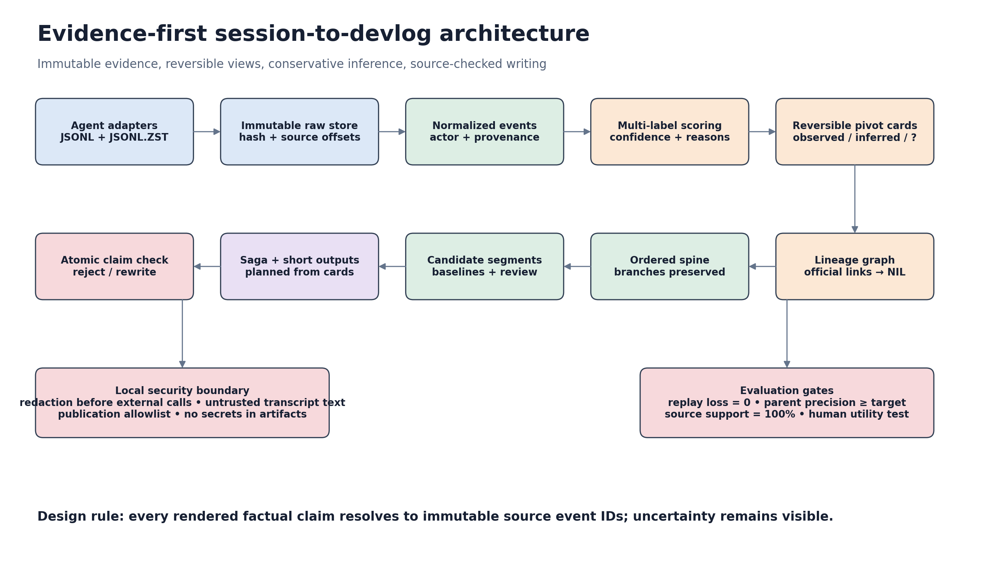

# Session-to-devlog：深度事實核查、風險審計與修訂建議

**核查日期：2026-11-10**

**核查對象：**《Session-to-devlog tool: build brief》

**範圍：**平台事實、輸入資料、模型與算法、跨線程關係、生成可靠性、安全隱私、競品、評估及 build order。

**核查限制：**只使用公開文件、源碼、issue、論文及項目頁；沒有讀取任何私人 Codex／Claude 資料庫或真實用戶 transcript。GitHub issue 反映特定版本的 reproducible report，不等於所有安裝都會出現；官方文件則可能落後於快速變動的產品。

## Executive summary

這份 brief 的**核心產品方向成立，現有技術亦足以做出原型**，但它現時仍未適合直接當作 implementation specification。最值得保留的是：以原始 session 為證據、把低分事件可逆地附到 pivot、用 cards 作中間表示、自動連接相關 threads，以及先組織長篇敘事再輸出短格式。最需要修改的不是「要不要做」，而是把**確定性資料、模型推論、產品判斷**分開：Codex rollout、Claude transcript、Git diff 是可重放的證據；pivot、trigger、parent 及 saga 文句則是可能出錯的解釋。若 schema 不區分這兩層，工具會把猜測寫成歷史事實。

平台調查補上了 brief 最大的未知數：**Codex 插件可以附 lifecycle hooks，Claude Code 與 Grok Build 也有可用的 hook／session surface**。不過 hooks 只改善捕捉時機與恢復，不應成為唯一資料來源；crash、kill、舊版本及不支援插件的宿主仍需要 scanner 補回。輸入層亦要擴充至 `.jsonl.zst`，不能假設所有 rollout 都是 plain `.jsonl`。「Resume keeps the same thread id」是正常 API 合約，但已有 resume 意外產生新 ID 的 issue，因此應以 metadata 和內容去重，而不是把 ID 當成絕對身份。

模型方面，brief 對 Jev 的版本、primitive 和牌價描述基本正確，但**沒有證據顯示 Jev 在 coding-session pivot detection 上優於一般 LLM 或簡單 baseline**。grammar-constrained output 只能保證格式，不能保證語義或機率校準。五桶 taxonomy 可以保留作產品 schema，但應改為 multi-label，並允許 `unknown`；parent inference 應以高精度和 `NIL` 為目標，不能只用官方 fork／subagent positives 校準。生成方面，plan-then-write 有研究支持，但不足以消除 hallucination；saga、devlog 和 highlights 的每個實質 claim 都應指向原始事件，並在發布前做 source-support check。

競品結論要改寫。`lordshashank/devlog` 已直接由多種 coding-agent transcripts 生成敘事 blog；DevRecap 已結合 Codex、Claude 和 Git 生成 evidence-backed workstreams；OpenViking 的 Codex plugin 已實作增量捕捉、compaction 前保存及 crash 後 sweep。這些項目不必然同時提供 brief 的完整組合，但足以否定寬泛的「nobody fills this」說法。真正可測試的差異化是：**pivot cards 的解釋結構、保守跨線程 saga、可逆視圖，以及所有長短輸出的逐 claim 證據鏈**。

**建議 GO，但有條件：**先做 offline CLI／library 和單線程 vertical slice，不要一開始承諾多宿主 plugin。只有通過無損 replay、標註可靠性、來源支持和人工實用性 gate，才加入自動 parent inference；只有證明跨線程敘事比單線程 timeline 更有價值，才擴展 Claude／Grok 包裝。

## 1. 總體判定與核查方法

本報告把 brief 中的句子分成五類。**Verified** 表示主要一手來源直接支持；**qualified** 表示方向正確但條件或例外不足；**incorrect/outdated** 表示目前會誤導實作；**unsupported** 表示來源不足以支持其強度；**product decision** 表示是可測試的設計選擇，不應假裝成研究共識。這個區分很重要，因為 brief 同時記錄 call decisions、研究建議和 open questions，而三者的證據責任不同。例如「五桶 taxonomy」可以是已決定的產品需求，但不存在一個公認標準證明它是最佳分類；「先做 saga」同樣是產品選擇，而不是由 data-to-text 論文直接推出。

研究方法以官方平台文件和源碼為先，issue 用作反例與兼容性風險，論文用作方法依據，競品 README 只證明該項目自己公開宣稱的功能。沒有把搜尋不到當成不存在，也沒有把單一 bug report 當成普遍故障。對會隨版本改變的說法，結論只適用於本次核查日期；實作仍需用版本化 fixtures 和 installed-version smoke tests 守住。

### 1.1 最重要的結論

第一，**技術可行性高，敘事正確性未證明**。解析 JSONL、建立 common schema、產生 cards 和文章都是常規工程；真正困難是判斷哪些事件構成轉折、事件之間是否有因果、兩個 threads 是否屬於同一工作，以及生成文字是否忠於證據。這些不能由 typed output 或漂亮文章解決，必須有獨立標註與評估。

第二，**pipeline 順序應微調而非推翻**。建議保留十步的產品概念，但實作順序改為「immutable ingest → normalize → baseline cards → single-thread render → evaluation」，再做 parent linking 和 multi-thread saga。這與 brief 的 suggested build order 大致一致，差別是把安全、評估和 source pointer 提前為 foundation，而不是完成模型後才補。

### 1.2 不應過度解讀研究文獻

Brief 引用 PROV-DM、RST、FACTTRACK、ReLink、TextTiling、QMSum 等，作為設計啟發是合理的；但它們大多不是在 Codex sessions 上驗證。PROV-DM 提供 entity、activity、agent、usage、generation、derivation 等概念，不會自動決定「這個 tool call 導致那個設計決策」；RST 的 nucleus/satellite 可支持可逆 attachment，卻不證明低 pivot score 就是 satellite；TextTiling／C99 處理文本邊界，不證明 pivot-score valley 是故事邊界；FACTTRACK 和 turning-point 工作主要面向故事，不能直接移植其本體 ([W3C](https://www.w3.org/TR/prov-dm/), [TreeSeg](https://arxiv.org/abs/2407.12028), [FACTTRACK](https://arxiv.org/abs/2407.16347))。

因此，文獻應用來形成**可比較的候選方法和 baseline**，而非為預定方案背書。每個 stage 至少要保留一個簡單替代方案：規則式 event extraction、embedding-only linking、fixed-size segmentation、template rendering。如果複雜模型不能在 held-out sessions 上明顯勝出，就不應增加其維護成本。

## 2. 逐項事實核查

下表是需要直接修改或加註的主要內容。產品決策不判「真假」，但會指出其驗證條件；供應商資料則標成 vendor-reported，避免轉述成獨立測試結果。

| Brief 說法 | 判定 | 核查結果與必要修改 |
|---|---|---|
| Codex rollout JSONL 是 source of truth，SQLite 是 projection／index | **Verified，需實作限定** | 官方 App Server 將 persisted thread log 描述為 JSONL；changelog 亦描述 thread history materialization into SQLite。實作應以 rollout 重放為主，SQLite 只做 discovery／加速，不可假定投影完整 ([Codex App Server](https://developers.openai.com/codex/app-server), [Codex changelog](https://developers.openai.com/codex/changelog))。 |
| 只讀 `rollout-*.jsonl` | **Incorrect/incomplete** | 目前官方工具明確支援 compressed `.jsonl.zst`。adapter 必須同時處理 plain 與 compressed，並把 compression 納入 fixture ([Codex reference](https://developers.openai.com/codex/security/cli/reference))。 |
| Resume keeps the same thread id | **Qualified** | `thread/resume` 的合約是按既有 ID 重開；`thread/fork` 才複製到新 ID 並回傳 `forkedFromId`。但已有 resume-created fork 的 issue，故需異常檢測及去重，而非把此句當不變式 ([Codex App Server](https://developers.openai.com/codex/app-server), [issue #34972](https://github.com/openai/codex/issues/34972))。 |
| `forked_from_id`、`parent_thread_id`、`attached_thread_parent_id` 可用 | **Verified** | 官方 API 和源碼／migration 支持這些 lineage 訊號；它們覆蓋不同關係，不可混為同一「parent」。 |
| SQLite 可能缺 rollout 中的 parent edge | **Verified as a reported counterexample** | Issue #33670 提供 rollout 有 parent metadata、projection 無 `thread_spawn_edges` 的案例，支持以 rollout 優先 ([Codex #33670](https://github.com/openai/codex/issues/33670))。 |
| 不能靠第一列或 `role=user` 判斷真人 turn | **Verified as a reported counterexample** | Issue #22997 的 hidden developer goal continuation 足以否定簡單 heuristic。應結合 event type、payload provenance 和 adapter 規則 ([Codex #22997](https://github.com/openai/codex/issues/22997))。 |
| Codex 是否有 plugin-bundled hooks 尚未研究 | **Outdated** | 官方 plugin 機制可附 hooks；可用 SessionStart、Stop、PreCompact、SessionEnd 等做 capture timing 和 recovery。不要假設 plugin 覆蓋所有宿主，IDE／cloud surface 要分別測試 ([Codex plugins](https://developers.openai.com/codex/plugins), [Codex hooks](https://developers.openai.com/codex/hooks))。 |
| Hooks 增加 timing，不是比 transcript 更豐富的內容 | **Verified as design guidance** | Claude 常見 payload 包含 `session_id`、`transcript_path`、`cwd`；OpenViking 的 Codex plugin 也是從 transcript 增量讀取 ([Claude hooks](https://docs.anthropic.com/en/docs/claude-code/hooks), [OpenViking design](https://github.com/volcengine/OpenViking/blob/main/examples/codex-memory-plugin/DESIGN.md))。 |
| Hooks 可保證 session end 捕捉 | **Incorrect if treated as guarantee** | `SessionEnd` 只覆蓋 graceful exit；SIGTERM、關 terminal、kill -9、crash 可不觸發。需要 Stop 增量、PreCompact 和下次 startup sweep ([OpenViking Codex docs](https://docs.openviking.ai/en/agent-integrations/04-codex))。 |
| Claude transcripts 30 日後預設刪除 | **Qualified** | 一般本地 retention 的 `cleanupPeriodDays` 預設為 30 日，但 Desktop／Cowork 等有豁免；應寫成「常見 CLI 預設，實際以 effective settings 為準」([Claude settings](https://code.claude.com/docs/en/settings))。 |
| Claude `/branch`／`/clear` 的 on-disk parent lineage 未證實 | **Still open** | 不應從 UI 行為推斷 transcript 必有 parent pointer。先檢查版本化 fixtures；沒有明確 metadata 就走保守推論或 NIL。 |
| Codex stable CLI 為 `rust-v0.167.0`，2026-11-06 release | **Verified at research time** | 可作版本快照，不可硬編為支援上限。記錄 adapter tested versions，並在 CI 對新 release 跑 fixture ([Codex releases](https://github.com/openai/codex/releases))。 |
| Jev `Choice`、`Score`、`Noul`、`Box`；`jev-1.14.0`；輸入 $0.042/M、輸出免費 | **Vendor-verified** | 與供應商文件一致，但價格和版本是會變的 vendor facts，不是性能證據 ([TypeSafe System One](https://docs.typesafe.ai/concepts/system-one))。 |
| Jev typed probabilities 足以得到校準 pivot confidence | **Unsupported** | Structured output 可限制答案空間；task calibration 仍需在獨立標註集驗證。群體校準不保證單一答案正確 ([Jagannatha & Yu](https://arxiv.org/abs/2004.04361))。 |
| 每個 event 只有一個五桶 label | **Product decision，建議修改** | 一個事件可同時包含 alternative 和 decision，或 obstacle 和 outcome。用 multi-label 加 primary label，允許 `unknown`，避免強制單選 ([Argus](https://arxiv.org/abs/2604.10345))。 |
| 低分事件可逆附到最近 pivot | **Reasonable design hypothesis** | 與 nucleus/satellite 概念相容，但需測試 attachment accuracy；raw events 永不刪除 ([RST](https://doi.org/10.1515/text.1.1988.8.3.243))。 |
| Card 必須有完整 before／trigger／after | **Product decision，需加狀態** | 很多 session 沒有明確 outcome 或 causal trigger。每欄應是 `observed`、`inferred`、`unknown`，而不是逼模型填滿。 |
| 官方 fork／subagent pairs 可校準 linking threshold | **Incorrect/incomplete** | 它們主要是 positives，不能估計 false-link precision。必須加入同 repo、同 branch、相近時間的 hard negatives，以及跨時間／項目 held-out split ([Izadi et al.](https://arxiv.org/abs/2211.00381))。 |
| Lore 的 0.6 可作起點 | **Qualified** | 只能作另一產品的 default，不能作本工具 threshold。應按目標 precision 選 threshold，並公布 coverage。 |
| TextTiling 後用 C99「升級」 | **Unsupported wording** | C99 不是在此資料上的必然升級。與 fixed gap、TextTiling、TreeSeg、supervised boundary baseline 並排比較 ([C99](https://arxiv.org/abs/cs/0003083), [TreeSeg](https://arxiv.org/abs/2407.12028))。 |
| Plan-then-write 加 faithfulness check 可避免虛構 | **Qualified** | Content planning 有依據，critic decoding 可減少而非消除 hallucination。需要逐 atomic claim source check，不能只做一次整篇評分 ([Puduppully et al.](https://arxiv.org/abs/1809.00582), [Lango & Dušek](https://arxiv.org/abs/2310.16964))。 |
| 短格式應從 cards／source events 選材 | **Supported** | 與 query-based locate-then-summarize 一致；不要只壓縮 saga，否則會繼承其遺漏與錯誤 ([QMSum](https://arxiv.org/abs/2104.05938))。 |
| 現有工具沒有共同填補所列 gaps | **Not established** | 搜尋本身不完整，而且已有直接重疊的 DevLog、DevRecap、OpenViking。改成「本次樣本中未驗證到完全相同組合」，並維持 feature matrix。 |
| Transcripts 含 secrets，要在 model 和 publish 前 redact | **Verified and high priority** | 官方 Codex Security 文件亦警告 diagnostics 可含 source code／credentials。Redaction 是必要非充分控制，還需最小化欄位、權限和發布審查 ([Codex Security](https://developers.openai.com/codex/security/cli/reference))。 |

## 3. 輸入、身份與插件：應如何落地

### 3.1 Codex ingestion 不是單純「讀 SQLite」

Brief 開頭一句「pipeline ingests Codex SQLite session databases」會把實作帶向錯誤中心。建議改成：**pipeline ingests immutable rollout logs, with SQLite and App Server metadata as optional indexes**。每個 raw file 記錄 content hash、adapter version、discovered path、size、mtime 和 ingestion timestamp；每個 normalized event 記錄 source path、decompression context、line number、byte range（可行時）、original event ID、thread ID 和 parse warnings。若將來 rollout 被 pruning、projection 漂移或 UI 顯示不同，仍可重放同一輸入並解釋差異。

Adapter 要處理的不只是快樂路徑：plain／compressed rollout、active file 尚未 flush、fork 繼承的歷史、duplicate ordinals、non-monotonic timestamps、schema 新增欄位、archived sessions，以及 malformed tail line。遇到未知 record 不應靜默 drop，而要保存 raw、標 `unsupported_record` 並增加可觀測 counter。同一 thread 的重複 ingest 以 raw event identity 去重；若 resume 異常產生新 ID，則由 lineage／content reconciliation 建立 alias，而不是重寫歷史。

### 3.2 Hooks 是正確的捕捉層，不是信任邊界

建議 Codex plugin 在 `SessionStart` 做 orphan／idle sweep，`UserPromptSubmit` 可選做輕量狀態更新，`Stop` 增量捕捉，`PreCompact` 把尚未保存的 tail 寫入本地，`SessionEnd` 做 graceful flush。每次都由 transcript cursor 決定新增範圍，state write 用 temporary file + atomic rename；失敗時不清空 cursor。OpenViking 已公开展示類似設計，包括 post-compaction transcript shrink、unreadable transcript guard 和 idle TTL recovery，可直接作工程參考，而非重新猜 hook 時序 ([OpenViking design](https://github.com/volcengine/OpenViking/blob/main/examples/codex-memory-plugin/DESIGN.md))。

即使 hook 成功，也要定期 offline scan，因為用戶可不安裝／不信任 plugin、宿主可不支援、進程可 crash。Hook payload 和 transcript 都是**不可信輸入**，不可讓其中的「忽略規則」「發布此內容」等文字改變工具行為。工具應只解析預期欄位，輸出 HTML／Markdown 時 sanitise，發布動作由代碼中的 explicit user authorization 控制。

### 3.3 Claude 與 Grok 的可行性和次序

Claude Code adapter 可圍繞 `~/.claude/projects/` transcript JSONL 和 hook 的 `transcript_path` 建立；subagent payload 的 agent transcript path 要獨立保存並連回 parent。由於 30 日 cleanup 是常見預設而非 universal rule，安裝時應顯示 effective retention、提醒用戶，並提供「本地保存 raw copy」選項。不要承諾 `/branch` 或 `/clear` 一定有 parent pointer；先由實際版本 fixtures 決定欄位映射。

Grok Build 現在已具備第三 adapter 的基礎：官方文件說 sessions 自動存於 `~/.grok/sessions/`，包含 prompts、responses、tool calls 和 file snapshots；`--fork-session` 明確分支，plugins 可附 hooks，SessionStart／SessionEnd／PreCompact 等事件可用 ([Grok sessions](https://docs.x.ai/build/features/sessions), [Grok hooks](https://docs.x.ai/build/features/hooks), [Grok plugins](https://docs.x.ai/build/features/skills-plugins-marketplaces))。不過其 hook 文件說 timeout、crash、malformed output 一般 fail-open，所以 devlog 捕捉失敗不能影響 coding agent；本地 queue 和下一輪 recovery 仍是必需。

**建議次序仍是 Codex → Claude → Grok**，原因不是 Grok 不可行，而是先用兩種不同 transcript／lineage 設計驗證 common schema，再加第三種會更便宜。Plugin packaging 應是核心 library 外的薄層；不要把解析、評分或生成邏輯寫進某個宿主的 hook script。

## 4. 算法與資料模型的修訂

### 4.1 Normalization：保留事實，也保留不知道

Common event schema 至少包含 `event_id`、`source`、`thread_id`、`logical_session_id`、`timestamp`、`actor`、`event_kind`、`payload_ref`、`parent_event_refs`、`parse_status` 和 `adapter_version`。`event_kind` 可用 thought／action／result 作上層類別，但原始類型不可覆蓋，因為 user prompt、tool call、file diff、test result 和 compaction 對後續判斷有不同證據價值。Thought-action-result 研究支持這種 trajectory 視角，但不提供 Codex 的完整 mapping ([Bouzenia & Pradel](https://arxiv.org/abs/2506.18824))。

「What changed」不應是一個自由文字欄，而應拆成 observable effects 與 interpretation。Observable effects 包括 command exit code、test summary、file path、diff hash、commit SHA；interpretation 包括「此修改修好了 race condition」。後者需要證據和狀態。PROV 的 used／wasGeneratedBy 可描述活動使用了什麼、產生了什麼，但 causal derivation 仍須另行判斷；不可把時間相鄰當成因果 ([W3C PROV-DM](https://www.w3.org/TR/prov-dm/))。

### 4.2 Scoring：先做多標籤，再決定是否用 Jev

建議保留五個產品標籤，但輸出改為 `labels[]`、`primary_label`、`pivot_score`、`reason_codes[]`、`evidence_event_ids[]`、`abstain_reason`。一個 turn 可以同時提出 alternative 並作出 decision；一個 failed test 同時是 obstacle 和階段性 outcome。加入 `unknown` 和 `not_applicable` 能防止模型為符合 schema 而亂選。標註 guide 要定義 event boundary、hindsight rule、evidence requirement 和邊界案例，並用至少兩名標註者抽樣計算 agreement；不一致案例應修訂 guide，而非只取多數後忘掉。

Jev 應與三組 baseline 做同一 bake-off：deterministic rules／small classifier、general LLM constrained JSON、embedding similarity plus threshold。比較 macro-F1、per-label precision／recall、pivot average precision、selective risk、coverage、latency 和成本。Grammar-constrained decoding 可確保 JSON／enum 形狀，但沒有保證答案忠於 transcript；probability 也需在 held-out data 上做 reliability diagram、Brier score 或 expected calibration error，而非直接當真實信心 ([Geng et al.](https://arxiv.org/abs/2305.13971), [Jagannatha & Yu](https://arxiv.org/abs/2004.04361))。

按供應商牌價，Jev 每 1M input tokens 為 **$0.042**，所以純 input 成本為 50K tokens＝$0.0021、500K＝$0.021、5M＝$0.21，output 牌價為零 ([TypeSafe](https://docs.typesafe.ai/concepts/system-one))。這只是模型調用成本，不含 tokenization overhead、retry、context construction、embedding、writing model 和儲存；低單價也不能代替效果測試。

### 4.3 Clustering 與 cards：可逆不代表正確

Clustering 應產生獨立的 `attachment(edge)`，包含 satellite event、pivot、score、method、model version 和 evidence。預設只在連續窗口內 attach，遇到新 goal、明確 topic shift、長時間 gap 或另一高置信 pivot 就停止。「Nearest」不應只按時間最近，否則後續 unrelated debugging 會被吸入上一個大事。低分事件仍可在 raw timeline 展開，任何 cluster 都能 flatten；生成器可選擇是否讀 satellites，但不可改變 raw store。

Pivot card 建議欄位為：`card_id`、`title`、`goal`、`before_state`、`trigger`、`considered_alternatives`、`decision`、`actions`、`after_state`、`outcome`、`open_questions`、`evidence_refs`、`epistemic_status`、`model_version`。每個 state 欄位都要能標 observed／inferred／unknown；inferred trigger 必須附 reason 和 supporting events，沒有證據就留空。這比強制完整故事更符合真實工程：很多 session 以未解 blocker 結束，並沒有 resolution。

### 4.4 Parent inference：高精度的圖，而非勇敢的一條鏈

Parent inference 應分兩層。**Deterministic lineage** 只讀官方 fields、明確貼上的 thread／issue references、可驗證的 subagent relation；每種關係保留 type，例如 `fork_of`、`spawned_by`、`attached_to`、`explicitly_references`。**Probabilistic continuation** 只處理「fresh thread 是否延續舊工作」，輸出 parent 或 NIL，附 candidate scores、time gap、repo／branch、file overlap、text similarity 和 model version。Official metadata 缺失時不可自動當成沒有 parent。

訓練／校準集要包括 official positives、人工標註 continuations、不相關 easy negatives，以及同 project／同 branch／同 issue 的 hard negatives。按時間和 project 切分 train／dev／test，防止相同文字或 repo 洩漏。Threshold 以目標 precision 選，例如 **accepted links precision ≥95%**，同時報告 coverage；接近的 top two candidates 直接 NIL。 False link 會把整段無關工作帶入 saga，所以這裡不應追求最高 recall。

### 4.5 Spine 與 segmentation：保留 DAG，提供線性視圖

真實工作常有並行 subagents、backtracking、cherry-pick 和多個未完成分支，不應強行合成唯一 causal chain。內部模型應是有向圖：timestamp 提供弱次序，official lineage 和 evidence-backed dependencies 提供強約束；若出現 cycle，不應由 topological sort 靜默丟邊，而要標 conflict 並回退到分組 timeline。「One spine per saga」可保留為**閱讀視圖**，但 UI 和 IR 要保留 branch references，讓讀者知道哪些路線沒有合流。

Segmentation 不應預設 C99 較好。Baseline 可包括固定 token／event window、time-gap rule、TextTiling、TreeSeg 和 pivot-valley heuristic；以人工標記的 story boundaries 比較 Pk、WindowDiff 或 boundary F1，並檢查 chunk size distribution。TreeSeg 對大型 transcript 的 hierarchical segmentation 尤其適合作為結構性替代方案 ([TreeSeg](https://arxiv.org/abs/2407.12028))。Time gap 只表示活動中斷，不必表示主題改變；它可以是 soft feature，而非單獨硬切。

### 4.6 Generation：文章是受控視圖，不是新證據

Writer 輸入應包括 segment cards、必要 satellites、原始 source excerpts 和明確未知項，先輸出 outline，再輸出帶 evidence IDs 的 claim plan，最後才生成 prose。文章可以潤飾連接和節奏，但不可新增 goal、decision、test result、performance number 或 causal explanation。Content selection／planning 研究支持把組織和句子生成分開，QMSum 支持先定位再按 query 摘要；兩者都不保證本工具自動忠實 ([Puduppully et al.](https://arxiv.org/abs/1809.00582), [QMSum](https://arxiv.org/abs/2104.05938))。

發布前把長文和短文拆成 atomic claims，逐項對 source refs 做 support check。Commit SHA、file path、test count、日期和 exit code 由 deterministic validator 查核；語義 claim 可由獨立 verifier 初篩，但低信心或無引用要 reject／rewrite。Critic-driven decoding 可作額外防線，不應取代 source validation ([Lango & Dušek](https://arxiv.org/abs/2310.16964))。短 devlog 和 highlights 直接從 cards 選材並重新核證，而不是只壓縮 saga；所有格式共享同一 claim ledger，避免 saga 修好了、短帖仍保留舊錯。

## 5. 競品與差異化：需要重新定位

### 5.1 Brief 的競品敘述低估了直接重疊

最接近的新增反例是 `lordshashank/devlog`：其公開 README 明確說會讀取 coding session transcripts、選擇相關 sessions、生成關於 human-agent collaboration 的敘事 blog，支援 builder’s log、tutorial、technical deep-dive，並列出 Claude Code、Codex、OpenCode 等宿主及 Hashnode publishing ([DevLog](https://github.com/lordshashank/devlog))。它未必有 pivot-confidence、可逆 clustering 或 conservative parent inference，但已覆蓋「session → narrative devlog → publish」和「多 agent」這兩個核心表面價值。因此不能只把它當一般 transcript formatter。

DevRecap 則公開描述由獲授權的 Codex／Claude history 和 read-only Git evidence 重建 workstreams，區分 completed、investigations、in progress、blockers／next steps，並由 host AI 寫作、工具驗證 factual layer ([DevRecap](https://github.com/openai/codex/discussions/47404))。OpenViking 不是 devlog 產品，但其 Codex plugin 已解決多個 ingestion 難題：Stop 增量、PreCompact 保存、SessionEnd flush、startup recovery、transcript cursor 和 session archive ([OpenViking](https://github.com/volcengine/OpenViking/blob/main/examples/codex-memory-plugin/README.md))。此外，claude-code-sessions 已提供跨 project 搜尋、replay、analytics 和 standup preparation，代表「瀏覽與回顧」本身也不是空白市場 ([Claude Code Sessions](https://github.com/kmizzi/claude-code-sessions))。

### 5.2 可防守的定位應更窄

建議把 positioning 改成：**「Evidence-linked engineering narratives built around decision pivots, with conservative cross-session lineage and reversible detail views。」**這句話包含四個可演示差異，而不是聲稱世上沒有其他工具。Demo 應直接比較同輸入下的 raw transcript summary、普通 blog generator 和本工具：本工具要展示一個 alternative 被考慮但未採用、一個失敗路線保留在故事中、一個 fresh thread 被高精度連回、每句關鍵敘述可跳回原始事件，以及低信心 parent 被明確拒絕。

競品 matrix 應持續更新，欄位包括宿主、raw provenance、decision pivot model、reversible attachment、lineage／NIL、Git verification、long-form planning、short-format claim checks、local/privacy 和 publishing。沒有檢查源碼的功能只能寫「README claimed」，不能寫「沒有」。市場需求也不能由功能缺口推出：下一步應用 5–8 名實際 coding-agent 用戶測試他們是否願意重讀、分享或每週生成 saga；若只需要 standup bullets，長篇 saga 可能是次要格式而非核心。

| 工具 | 已公開的重疊能力 | 本工具仍需證明的差異 |
|---|---|---|
| DevLog | 多 agent transcripts → 敘事 blog；多種文章風格；發布 | Pivot/state cards、可逆細節、保守 lineage、逐 claim evidence gate |
| DevRecap | Codex＋Claude＋Git；workstreams；evidence-backed status | 跨 thread saga、轉折與 alternatives 的敘事結構 |
| OpenViking | Codex capture hooks、compaction、recovery、session archive／memory | 不競逐 memory recall；專注可發布的工程敘事 |
| claude-code-sessions | 搜尋、replay、analytics、standup | 非 dashboard，而是可稽核的故事與 decision history |
| Session Story／DiffStory 等 brief 已列工具 | Typed IR、prompt-to-edit、diff verification、story arc | 需逐版本維持 matrix，不以單日搜尋作「無人做到」結論 |

## 6. 安全、隱私與發布邊界

### 6.1 Redaction 必要，但不是完整答案

Coding transcripts 可能含 proprietary source、unreleased plans、absolute paths、customer names、access tokens、cookies、private keys 和 command output。官方 Codex Security 文件也明確警告 diagnostics 可以包含 source code 或 credentials，分享前要審查 ([Codex Security](https://developers.openai.com/codex/security/cli/reference))。因此 raw store 應預設 local-only、權限最小化、不進 telemetry；external model request 只送該 stage 所需欄位，先移除工具輸出大 blob、environment dumps 和未必要 code。Secret detector、entropy rules 和 custom denylist 可減少外洩，但不能保證找出所有敏感內容。

更穩妥的資料流是雙層 redaction：**model-input redaction** 在評分／寫作前執行，保留 placeholder 與原文的本地映射；**publication redaction** 是獨立、較嚴格的 allowlist，不把本地路徑、內部 repo 名、顧客名和 credential-shaped strings 帶進文章。每次生成保存 redaction policy version 和 findings count，但不把秘密寫進 debug log。高敏感 repo 應提供 local-model／no-network 模式；若無法安全處理，就拒絕 external generation，而不是靜默傳送全文。

### 6.2 Transcript 是不可信內容，發布要獨立授權

Transcript 中的使用者文字、tool output、網頁內容和 code comments 都可能含 prompt injection。OWASP 建議把 retrieved documents、tool results、conversation history 全部視為 untrusted，並指出單純標記或 filtering 不是完整防線 ([OWASP](https://cheatsheetseries.owasp.org/cheatsheets/LLM_Prompt_Injection_Prevention_Cheat_Sheet.html))。本工具在分析時不應有執行 transcript instructions 的權限；model 不可直接呼叫 publish、delete raw data 或改 security policy。任何發布都由確定性代碼檢查目標、內容範圍和用戶確認。

輸出 Markdown／HTML 亦要 sanitise，防止 transcript 中的 HTML、links 或圖片引用變成追蹤／洩漏。Publishing 預設關閉，先輸出 local preview 和 redaction diff；公開版另外生成，不假定私人 devlog 可直接公開。NIST 的 GenAI profile 把 confabulation、data privacy、information integrity 和 provenance 都列為風險，與本工具的「錯故事＋秘密外洩」雙風險完全對應 ([NIST](https://airc.nist.gov/docs/NIST.AI.600-1.GenAI-Profile.ipd.pdf))。

## 7. 評估計劃：每個 stage 都要有可拒絕的 gate

目前 brief 最大的工程缺口不是算法，而是沒有可判定「做得好唔好」的測試。以下指標是建議初始 gate，不是行業標準；前 20–30 個 sessions 完成標註後可按風險調整。所有 gate 都要保存 dataset version、model／prompt version、adapter version 和 confusion examples，避免只報一個平均分。

| Stage | 測試集與 baseline | 核心指標 | 建議 go/no-go gate |
|---|---|---|---|
| Ingest | 版本化 Codex／Claude／Grok fixtures；plain、zst、fork、compact、crash tail、malformed line | Raw event replay count、未知 record 數、idempotency、source-pointer coverage | **已知 fixture 零靜默遺漏；100% normalized events 可追溯；重跑無 duplicates** |
| Human-turn filter | 人工標註 user／developer／tool／system 邊界，含 late first real prompt | Human-turn precision／recall、false-human rate | 任何 hidden developer 被當真人都要作 high-severity failure 審查 |
| Taxonomy | 雙人標註、multi-label gold；rules／general LLM／Jev | Macro-F1、per-label recall、agreement、abstention | 明顯勝過多數類別和 rules baseline；否則不增加模型複雜度 |
| Pivot score | 時間點可見資訊標註，禁止 hindsight | Average precision、selective risk、calibration、coverage | 在 held-out threads 穩定，且低置信可 abstain |
| Attachment | 人工判斷 satellite 是否屬於 pivot | Edge precision／recall、wrong-pivot rate、可逆性 | Raw 永不改；錯附可一鍵 flatten；高精度優先 |
| Cards | 逐欄 observed／inferred／unknown 審核 | Slot accuracy、unsupported trigger rate、unknown 保留率 | **Observed facts 100% 有 refs；不接受虛構 outcome** |
| Parent links | Official positives＋人工 continuations＋same-project hard negatives；時間／project split | Accepted-link precision、coverage、NIL accuracy、top-2 ambiguity | **Precision ≥95% 才自動入 saga；否則只作候選或不連** |
| Spine | 並行、分支、cycle、timestamp conflict | Order violations、lost branches、cycle handling | 不可為 topo sort 靜默丟事件；branch 可展開 |
| Segmentation | 人工 story boundaries；fixed-gap／TextTiling／TreeSeg baselines | Boundary F1、Pk／WindowDiff、chunk size | 勝過最簡 baseline；否則保留簡法 |
| Saga／shorts | Atomic claim audit＋讀者評審 | Source-supported claims、identifier accuracy、coverage、utility | **發布前 100% material claims 有 support；無引用即拒絕／改寫** |
| Security | Secret canaries、injection fixtures、HTML payload、denied publish | Secret leakage、policy bypass、unauthorized action | 任何 raw secret 或未授權發布均停止 release |

### 7.1 數據集設計比模型選擇更優先

第一個標註包建議包含 20 個單線程 sessions：成功功能、debugging dead end、明確 alternative、未解 blocker、compaction、subagent、長時間 gap 和純雜務。第二個包包含 10 組 thread families：official forks、subagents、明確 continuation、相同 repo 但無關、相同 issue 但新任務、時間相近但不同目標。所有標註只使用當時可見內容，另設一個「hindsight label」欄供分析，不讓它污染 pivot gold。這會直接測試 brief 提到的 hindsight bias。

Parent-link 評估尤其不能只用 official pairs，因為那會把「看到 official field」與「從內容推斷 continuation」混在一起。測試 inference 時要遮蔽官方 parent fields，並確保同一 repo 的近似文字不跨 train／test。若自動 link 達不到 precision gate，產品仍可交付單線程 cards／saga 和 deterministic forks；不要為了完整十步而降低證據標準。

### 7.2 人工評審要測「有用」，不只是「好睇」

文章質素至少分四個維度：事實忠實、重要 pivot coverage、叙事連貫、對讀者的行動價值。讓原作者和沒有參與工作的工程師分別評分：原作者能指出遺漏／錯誤，外部讀者能測試是否真正理解「為何這樣做」。與普通 chronological summary 和現有 DevLog 類輸出盲比，若 pivot-card 版本只更長但沒有更清楚，就不應把長篇當主要成果。

Shorts 要獨立檢查 blocker、failed alternative 和 unresolved state 是否被遺漏。Highlight 的「juicy」只能改變選材和文風，不能提高確定性；未知 outcome 不可寫成成功，conversation claim 與 diff 不一致時要顯示 conflict。最終產品可提供 evidence coverage 百分比和 unresolved count，讓讀者知道故事的證據邊界。

## 8. 修訂後 build order 與交付閘門

### Phase 0 — 凍結證據合約（1 個小迭代）

建立 event、source pointer、card、lineage edge、claim ledger schema；定義 observed／inferred／unknown、label guide 和 threat model。收集或合成不含秘密的版本化 fixtures，包含 `.jsonl`、`.jsonl.zst`、hidden developer、fork inherited history、compaction 和 malformed tail。**Gate：**任何後續輸出都能沿 refs 回到 raw；沒有 source pointer 的實作不進 Phase 1。

### Phase 1 — Offline Codex ingest 與 deterministic timeline

先做 CLI／library，不做 plugin UI。Scanner 讀 raw rollouts，SQLite 只輔助 discovery；normalize、去重、保存 unknown records，輸出簡單可檢查 timeline。加入 idempotent rerun 和 replay report。**Gate：**fixture 零靜默遺漏、100% 可追溯、重跑無 duplicates；這是整個項目的第一個硬門。

### Phase 2 — 單線程 cards 與 model bake-off

用 small labelled set 比較 rules、general constrained LLM 和 Jev，保留 multi-label、unknown 和 evidence refs。先做 rules-based cards，再由模型補充 inferred fields；生成可展開 satellites 的 card timeline。**Gate：**效果明顯勝過簡單 baseline，card observed facts 全有 refs，unsupported trigger／outcome 可被拒絕。若 Jev 沒有勝出，就不為它綁定架構。

### Phase 3 — 單線程 saga、short formats 與 faithfulness gate

先由 cards＋source excerpts 生成 outline／claim plan，再生成 saga；shorts 從 cards 獨立選材。建立 atomic claim validator、identifier checks、publication redaction preview 和 local-only output。**Gate：**material claims 100% source-supported，無虛構結果，人工盲評優於普通 chronological summary。若只做到「文章順眼」但證據不通過，不能進入多線程。

### Phase 4 — Codex plugin capture 與 recovery

把成熟核心包成薄 plugin：SessionStart sweep、Stop incremental、PreCompact flush、SessionEnd graceful commit；所有操作失敗不影響 coding session。保留 offline scanner，顯示 last capture、pending retry 和 redaction mode。**Gate：**crash／kill／compaction／resume fixtures 均可由下一輪恢復；hook failure 不丟 raw，也不泄露 secrets。

### Phase 5 — Deterministic lineage，再開放 probabilistic parent

先只支援 official forks、spawned subagents、attached relations 和 explicit refs，圖視圖保留 branches。之後才訓練／校準 fresh-thread continuation，輸出 parent 或 NIL；低於 precision gate 不自動合併。**Gate：**accepted-link precision ≥95%，hard negatives 通過，time／project held-out 無明顯崩跌；否則多線程 saga 只用 deterministic links。

### Phase 6 — 多線程 saga 與 segmentation 選優

在 lineage graph 上建立可展開的 spine，比較 time-gap、TextTiling、TreeSeg 和 pivot-valley segmentation。對並行與未完成分支提供清晰呈現，不強造單一結局。**Gate：**多線程版本相對單獨 timelines 有明確人工效用提升，且 false-link／漏分支風險受控。

### Phase 7 — Claude、Grok adapters；最後才 publishing

Claude adapter 優先處理 retention 和 subagent transcripts；Grok adapter 使用本地 sessions、explicit fork metadata 和 hooks。兩者共用核心，不複製 scoring／writing logic。Publishing 只在 security review、redaction diff、explicit confirmation 和 output sanitisation 完成後加入。**Gate：**每宿主獨立通過 ingest／lineage／crash fixtures；不以「有 plugin API」推定功能完全相容。

## 9. 建議直接改寫的 brief 條文

為方便把研究帶回 build brief，以下文字可直接取代最危險的幾句。這些不是新增產品需求，而是把已核實的例外和證據責任寫清楚。

| 原文方向 | 建議文字 |
|---|---|
| 「Pipeline ingests Codex SQLite session databases」 | 「Pipeline treats versioned Codex rollout logs (`.jsonl` and `.jsonl.zst`) as replayable evidence; SQLite/App Server metadata are optional indexes, never the sole source。」 |
| 「Resume keeps same thread id」 | 「Normal resume targets the same id and fork creates a new id; ingestion still detects anomalous resume-created forks and reconciles aliases from metadata/content。」 |
| 「Codex hooks unchecked」 | 「Codex supports plugin-bundled lifecycle hooks; use them for incremental capture, compaction and recovery, with an offline scanner because graceful SessionEnd is not guaranteed。」 |
| 「Each event gets a bucket」 | 「Each event may have multiple taxonomy labels plus a primary label, pivot score, reason codes, evidence refs and unknown/abstain states。」 |
| 「Before/trigger/after-state」 | 「Card fields distinguish observed, inferred and unknown; missing outcomes or causal triggers remain empty rather than being generated。」 |
| 「Calibrate on official fork/subagent pairs」 | 「Calibrate on positives plus same-project hard negatives, using temporal/project-held-out splits; select threshold by accepted-link precision and report coverage/NIL。」 |
| 「TextTiling, then C99 as upgrade」 | 「Benchmark fixed-window/time-gap, TextTiling, TreeSeg and pivot-valley methods; promote only measured winners。」 |
| 「Saga cannot invent」 | 「Every material claim in saga and derived outputs carries source refs and must pass deterministic/semantic support checks before publication。」 |
| 「Nobody fills gaps together」 | 「Direct prior art exists for multi-agent narrative devlogs, evidence-backed recaps and hook-based capture; differentiation is the measured combination of pivot cards, reversible detail, conservative lineage and source-checked outputs。」 |
| 「Redact before model」 | 「Raw data stays local by default; external calls receive minimized/redacted fields, transcripts are untrusted input, and public output undergoes a separate allowlist/redaction review。」 |

## 10. 最終建議

**建議繼續做，但把 MVP 定義收窄為「可追溯的單線程 decision narrative」，而非一開始就交付全自動跨 agent saga。**最小可驗證產品是：讀 Codex plain／compressed rollouts，輸出帶 source refs 的 cards 和一篇單線程 saga，保留失敗路線與 unknown，並能產生同樣受證據約束的短 devlog。這個版本已可測試核心價值，且不需要先解決最危險的 parent inference。

若這個 vertical slice 不能比現有 transcript summary 更準確、更有用，應停止加複雜算法，重新檢查用戶其實需要長篇故事還是工作回顧。若它通過，再加入 deterministic forks、保守 continuation linking 和多宿主 adapters。整體而言，brief 的研究廣度和產品直覺是好的；真正需要的是把「有文獻啟發」降格為待驗證假設，把「原始證據與不確定性」升格為整個系統不可繞過的合約。
