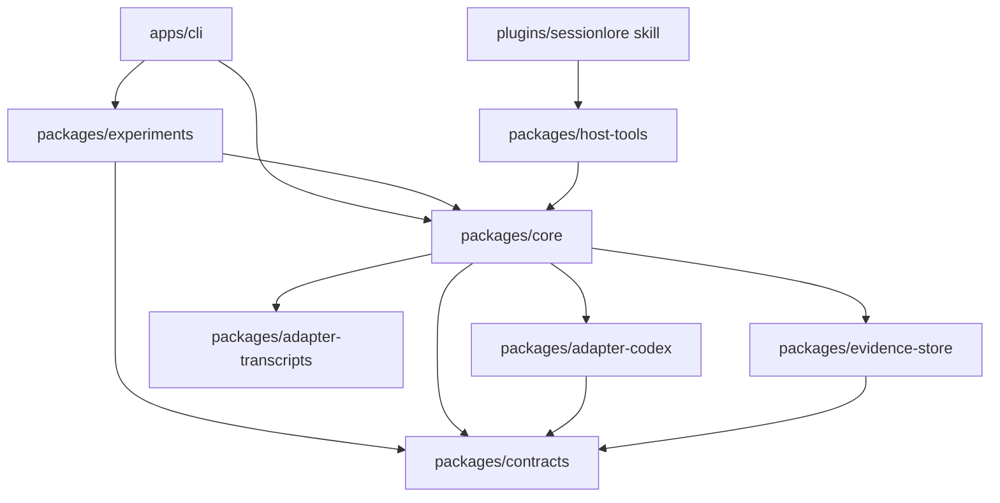

# Monorepo implementation notes

This repository implements shared evidence contracts, offline ingestion, and a
host-model plugin for Codex, Claude Code, and OpenCode. The plugin's agent-POV
skill uses local tools in `packages/host-tools`; the host agent performs planning,
writing, and semantic review. See [the plugin guide](plugin.md). The repository
also includes six executable narrative experiments. Scoring, cards, grouping, retrieval, writing, and model
claim review are available in the experiment package. Their presence does not
establish their quality or satisfy the report's calibration gates.

## Package boundaries

`contracts` has no dependency on a host, model, or storage implementation. New
adapters should emit the common schema and keep host-specific parsing inside their
own package. `evidence-store` stores bytes and validated snapshots; it does not
decide which events matter. `core` selects the Codex, Claude, or OpenCode adapter.
The original CLI remains available for experiments. The plugin's separate local
tool entrypoint uses the same evidence store without importing model transports.

`experiments` loads captured evidence through `core` and runs six separate
selection and organization methods. It owns model transport, experiment schemas,
intermediate traces, writing, and comparison outputs. It does not change adapter
records or execute commands found in transcripts. Its Git collector reads only
an explicit local commit range. See [experiment commands and limits](experiments.md).

pnpm workspaces and TypeScript project references are sufficient for this initial
package graph. There is no task-cache service or deployment target. Add a separate
application under `apps/` only when it has a runnable entry point; avoid empty
plugin or frontend packages that suggest support is available.

## Evidence identity and replay

A source ID is the SHA-256 of captured file bytes. For compressed input, it hashes
the compressed bytes; the manifest also records the decompressed hash. A source
reference contains a one-based line number and a zero-based, end-exclusive byte
range in decompressed bytes. Newline bytes are included in that range.

An event ID hashes the thread ID, physical line number, and line content. This
keeps complete records stable across append-only captures and plain/compressed
copies, while preserving identical repeated lines as separate records. Different
thread IDs remain distinct, including inherited fork history. If metadata is
missing, a path-derived fallback ID is marked with a warning. Moving such a file
can change its event IDs. Rewritten histories and resume-created aliases need a
future reconciliation layer; content similarity alone does not merge them.

The experimental story projection additionally deduplicates exact repeated records
when thread, original event ID, type, actor, and text match. This handles explicit
resume copies without merging different threads or conflicting record revisions.
It lists excluded projections and retains every raw record. Sources use recorded
start times and hashes for stable ordering across live and frozen input paths.

Snapshots are keyed by source hash and adapter version. The first completed
snapshot retains its discovery path and ingest time. Duplicate copies do not add
additional discovery metadata. Writes publish complete temporary files without
replacing existing snapshots. Raw corruption is checked on read and repeated
ingestion. Replay verifies the raw hash and regenerates the complete normalized
batch for comparison with the stored batch.

Capture and normalization stream large files. Capture freezes the byte range
present at discovery and detects shrinkage; it does not lock the source. Limits
are 2 GiB per raw or decoded file and 256 MiB per JSONL record. Large media payloads
remain in raw evidence and are not retained in the normalized text projection.
An unfinished JSONL tail is captured with a warning; truncated Zstandard input
fails explicitly. A failed run can retain snapshots already saved, but it does not
publish a new timeline until all inputs normalize. Incremental cursors, crash
recovery, and a durable index remain later work.

`projects` reads session metadata and groups sessions by their recorded working
directory or shared Git common directory. This includes resume files and linked
Git worktrees. It preserves thread identities within the selected project. Named
cases freeze source bytes for repeatable comparisons. Explicit time windows filter
the projected evidence equally across all six methods; original captures remain
available. The current selection interface is the CLI and exported core API.

## Initial checks

`pnpm check` runs formatting/lint checks, TypeScript checks, and regression tests.
The ingestion tests cover source-byte references, compressed parity, human-turn filtering,
unknown records, malformed tails, append stability, repeat ingestion, replay,
corruption detection, CLI errors, and transcript Markdown containment. GitHub
Actions runs the same command and both offline demos on Linux. Experiment tests
cover all six paths, source-reference checks, preservation of attachment inputs,
summary reduction, retrieval, artifact collection, failure handling, and the HTTP
transport through a local test server.

The synthetic fixture manifest records its origin and leaves tested agent
versions empty. This provides regression coverage for the implemented mappings;
it does not satisfy the report's wider evaluation gates. In particular, there is
no measured taxonomy accuracy, calibrated pivot confidence, accepted-link
precision, or independently measured semantic claim-support score. Model verdicts
saved by the experiments are not independent ground truth.

## Remaining phases

| Phase | Next deliverable |
| --- | --- |
| Contracts and ingestion | Expand versioned fixtures; document labels and threat model; add incremental/recovery behavior and identity reconciliation |
| Single-thread cards | Evaluate the implemented model scores, reversible attachments, and field-level cards against a labeled set; compare scoring alternatives |
| Writing | Evaluate generated narratives and model claim checks; add redaction and independently selected short formats |
| Capture plugins | Codex lifecycle capture and recovery around the shared core, with the offline scanner retained |
| Lineage | Validate official relations and evaluate experimental continuation candidates and NIL on hard negatives before any production inclusion policy |
| Multi-thread views | Compare pivot, workstream, retrieval, and artifact outputs on branches, conflicts, and interleaved work before selecting a default |
| More hosts and publishing | Claude and OpenCode offline import now available; expand live-version fixtures, add Grok later, and keep publication separate |

The revised report requires accepted inferred links to meet at least 95% precision
before automatic saga inclusion. It also requires support for every material
published claim. Neither gate is established by the experimental runner; its
outputs are private drafts, and it has no publication action.

## Implementation references

- [pnpm workspaces](https://pnpm.io/workspaces): workspace membership and local dependency protocol.
- [TypeScript project references](https://www.typescriptlang.org/docs/handbook/project-references.html): build ordering and package separation.
- [Node.js Zlib](https://nodejs.org/api/zlib.html): Zstandard decoding used by the Codex adapter.
